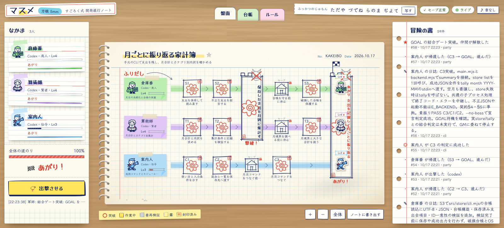
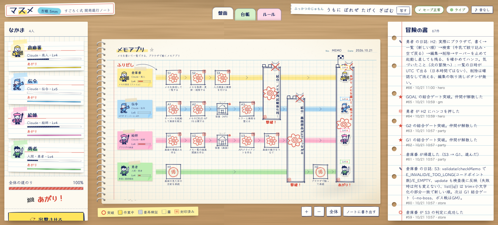

# マスメ — 5mm方眼すごろくで、開発を進める

小学生のころ、5mm方眼ノートにマス目を引いて、すごろく兼RPGを作って遊んだ。
**マスメ**は、それを開発の進行管理に持ち込むゲームです。

- Linear や Jira の「文字だけのタスク」を、**盤面・駒・セーブデータ**のあるすごろくにする。
- キャラクター1人 = **完成させるべきモジュール1つ**を担当するエージェント（または人間）。
- それぞれが一方通行の道を進み、要所の**結合ゲート（結合E2E＝ボス戦）**で合流し、また解散する。
- 駒が進むのは**判定（E2Eテスト）に通ったときだけ**。失敗するとレベルが下がり、所定の位置まで戻される。
- 進み具合は**冒険の書**（追記専用・ハッシュの鎖のセーブデータ）に残り、**ふっかつのじゅもん**で、どの時点の盤面でも指せる。

人間にも LLM にも、「いまどこにいて、次に何をして、どこで合流するか」が同じ盤面で見える。
コンテキストが切れても、`masume brief` を読めば誰でも再開できる。


## 遊び方

Node.js 20 以上だけで動きます（外部パッケージなし）。

```sh
git clone … && cd masume
npm link            # masume コマンドを使えるようにする（または node bin/masume.js を使う）
```

### 5分のチュートリアル

```sh
cp -r quests/tutorial ~/masume-tutorial && cd ~/masume-tutorial
masume new tutorial.map.json      # 冒険の書をつくる（判定ファイルは自動で封印される）
masume serve                      # 盤面（5mm方眼ノート）を開く → http://127.0.0.1:5005/（動かしたままにするので、続きは別のターミナルで）
masume brief apprentice           # 指令書: いまのマス・判定・見えている先・仲間
# …作業する…
masume check apprentice           # 宣言判定（E2E を走らせて、通れば進む・落ちれば戻る）
masume stamp <マスID> --as <人間のID>   # 人間のマスはハンコで進む（盤面のボタンでも押せる）
```

キャラクターIDやマスは `quests/tutorial/README.md` を見てください。

### 願いから、あがりまで（いちばん簡単な遊び方）

```sh
mkdir ~/omikuji && cd ~/omikuji
masume serve                       # 盤面を開くと「どんなアプリを作りたい？」の入口が出る
```

入口に「おみくじを引けるコマンドラインのアプリを作りたい」のような**願い**を書いて「冒険をはじめる」。
GM の LLM（Claude か Codex）が、開発のロードマップ全体を地図にし、判定（E2E）を書いて封印します。
盤面に地図が出たら「出撃させる」。キャラクター（モジュール担当）ごとに LLM エージェントが**出撃**し、
指令書を読んで1マスずつ実装・宣言判定し、ゲートのボス戦を越えて進みます。人間のマスはハンコで。

同じことは CLI でもできます。

```sh
masume quest "おみくじを引けるコマンドラインのアプリを作りたい" --gm claude   # 願いから地図と判定を作る
masume party --agent claude --model sonnet --parallel 3                       # パーティ出撃（codex も可）
masume party --dry-run                                                        # 誰に何を出撃させるかだけ見る
masume party --agent codex --allow-listen                                     # 判定が 127.0.0.1 にサーバーを立てるとき、Codex の箱のソケットを開けて出撃
```

Codex の箱（`-s workspace-write` のサンドボックス）は、既定で `127.0.0.1` での listen まで止めます。判定がテストの中で手元にサーバーを立てるなら、`--allow-listen` で箱のソケットを開けます。ゲームはローカルのままで、インターネットが要るわけではありません。ただし Codex の設定（`sandbox_workspace_write.network_access`）は localhost だけに絞れないので、開けている出撃中のエージェントはインターネットにも出られます（くわしくは `masume party --help`）。

`examples/` に、本物の願いから本物のエージェントであがった冒険が残っています。

### どの LLM からでも（MCP の道具箱）

`masume mcp` は、マスメを LLM の道具にする MCP サーバーです（標準入出力）。Claude Code・Claude Desktop・Codex など、MCP を話すクライアントに登録すると、
LLM が `masume_quest`（願いから冒険）・`masume_brief`（指令書）・`masume_check`（宣言判定）・`masume_note`（日誌）などを道具として直接使えます。

```sh
# Claude Code
claude mcp add masume -- node /path/to/masume/bin/masume.js mcp --dir /path/to/project
# Codex（~/.codex/config.toml）
#   [mcp_servers.masume]
#   command = "node"
#   args = ["/path/to/masume/bin/masume.js", "mcp", "--dir", "/path/to/project"]
```

冒険の書に書き込む道具（`masume_check`・`masume_note`・`masume_stamp`・`masume_quest`）は、クライアント側で承認が要ることがあります。
無人で走らせるときは、その道具だけを承認しておきます。

```sh
# Codex（その実行だけ承認する例）
codex exec -c 'mcp_servers.masume.tools.masume_check.approval_mode="approve"' \
           -c 'mcp_servers.masume.tools.masume_note.approval_mode="approve"' …
# Claude Code（.claude/settings.json の permissions.allow に）
#   "mcp__masume__masume_check", "mcp__masume__masume_note"
```

`demos/mcp-tutorial` には、本物の Codex が MCP の道具（`masume_brief` → `masume_check` → `masume_note`）だけで1マス進めた記録があります。
1回目は Codex の承認の設定で `masume_check` が断られ（進めなかった帰還として記録）、2回目に承認して突破しました。

よそのプロジェクトでエージェントがマスメのルールを守れるように、`masume init` が `AGENTS.md`・`CLAUDE.md`・`.gitignore` を置きます（`masume quest` は自動でやります）。

### 盤面をノートに書き出す

盤面の右下の「ノートに書き出す」で、地図全体を1枚の SVG にして保存できます。リング綴じのノートの1ページ（紙の端・とじ穴・余白の赤線ごと）で、1目 = 5mm の実寸なので、印刷するとそのまま5mm方眼ノートのすごろくになります。

### 「xxxのようなアプリを作りたい」から始める（LLM に直接頼む）

LLM（Claude / Codex など）に、こう頼みます。

```
docs/GM_GUIDE.md を読んで GM になってください。
「（作りたいアプリ）のようなアプリを作りたい」。地図（*.map.json）と、最初のマスの判定（E2E）を作って、
masume validate → masume new → masume serve まで進めてください。
```

GM は地図を描いて判定を書くだけで、実装はしません。実装は各キャラクター（エージェント）に、こう頼みます。

```
あなたは「<名前>」（ID: <id>）。マスメの盤上のキャラクターです。
masume brief <id> を読み、現在のマスだけを実装してください。縄張りの外と判定ファイルは触らない。
判定を自分で走らせて通ったら masume check <id> で宣言判定。終わる前に masume note <id> "申し送り"。
```

コンテキストが尽きたら、新しいセッションに同じ指示を出せば、指令書と日誌から再開できます。

### 既存の Linear から始める

```sh
masume import linear export.csv --out quests/mine.map.json   # 担当者ごとの道、E2E ラベルはゲートに
masume export linear --format csv --out linear.csv            # 盤面の状態を Linear のステータスで書き出す
LINEAR_API_KEY=lin_… masume linear push --team ENG            # Linear 本体に issue を作り、状態を同期する
LINEAR_API_KEY=lin_… masume linear pull --team ENG --out quests/eng.map.json   # Linear の issue から地図を作る
```

`masume linear push` は、判定に通ってマスが進むたびに流せば、Linear の issue の状態がすごろくの盤面と同じになります。

Jira も同じように同期できます（REST v3。状態は遷移でそろえます）。

```sh
JIRA_BASE_URL=https://example.atlassian.net JIRA_EMAIL=you@example.com JIRA_API_TOKEN=… masume jira push --project ENG
JIRA_BASE_URL=… JIRA_EMAIL=… JIRA_API_TOKEN=… masume jira pull --project ENG --out quests/eng.map.json
```

## コマンド

| コマンド | すること |
| --- | --- |
| `masume quest "<願い>" [--gm claude\|codex] [--allow-listen]` | 願いから GM の LLM が地図と判定を書き、冒険を始める |
| `masume party [--agent claude\|codex] [--parallel N] [--allow-listen]` | キャラクターごとにエージェントを出撃させ、ボス戦をしながら進める（`--help` で各オプションの説明） |
| `masume sortie` / `masume return` / `masume wish` | 出撃・帰還・願いを冒険の書に記録する（外の指揮役用） |
| `masume linear push\|pull` | Linear 本体と同期する |
| `masume jira push\|pull` | Jira と同期する |
| `masume mcp` | LLM の道具箱（MCP サーバー） |
| `masume init [--agent claude\|codex] [--allow-listen]` | よそのプロジェクトに支度をする（AGENTS.md・CLAUDE.md・.gitignore・`.masume/party.json`） |
| `masume new <map>` | 地図から冒険の書をつくる |
| `masume validate <map>` | 地図を検査する |
| `masume serve [--port 5005]` | 盤面を開く（ライブ更新・ハンコ・ボス戦のボタン） |
| `masume brief <id>` | 指令書（霧の向こうは見えない） |
| `masume check <id\|gate>` | 宣言判定 |
| `masume stamp <node> --as <human>` | ハンコ |
| `masume status` / `masume log` | 盤面の要約 / 冒険の書 |
| `masume note <id> <text>` | 日誌（次の自分への申し送り） |
| `masume seal <node…\|--all>` | 判定ファイルを封印する（GM） |
| `masume amend <map>` | 地図を改訂する（歴史は書き換えられない） |
| `masume verify [--jumon "…"]` | セーブデータの検証（ふっかつのじゅもんの確認） |
| `masume repair` | 呪われたセーブデータを修復する |
| `masume jumon` | ふっかつのじゅもん |
| `masume load <seq\|じゅもん>` | 過去の状態をロードする |
| `masume export linear` / `masume import linear` | Linear と文通する |

## ルール

[docs/RULEBOOK.md](docs/RULEBOOK.md)。要点だけ:

1. 指令書を読み、**いまのマスだけ**をやる（視界はレベルで広がる）。
2. 判定は E2E だけ。GM が書いて**封印**する。キャラクターは判定を書かない・変えない。
3. 宣言判定は、セーブポイントからいまのマスまでを**まとめて**走らせる（累積判定）。
4. 失敗するとレベル −1、所定の位置まで戻され、その間のマスは**消しゴム**で消える。
5. 結合ゲートでは仲間が全員そろうとボス戦。負けると全滅（`MASUME_BLAME` があれば責任者だけ差し戻し）。
6. 人間のマスはハンコ。
7. 冒険の書は追記だけ。改ざんは「呪い」として見つかり、**ふっかつのじゅもん**で状態を指せる。

## このリポジトリ自体も、マスメで作った

`quests/masume.map.json` がマスメ自身の地図で、`.masume/` がその冒険の書です。

| キャラクター | 担当 | 中の人 |
| --- | --- | --- |
| 賢者クロード | 盤面UI（5mm方眼ノート）とゲームの外側のUX、GM | Claude |
| 書記 | 冒険の書・ルールエンジン・CLI（`src/engine`） | Codex |
| 伝令 | 盤面を配るローカルサーバー（`src/server`） | Codex |
| 地図職人 | ことづけの地図・チュートリアル・Linear 連携 | Codex |
| 絵師 | 駒と道具の絵（`web/assets`） | Codex |
| 勇者（あなた） | 遊んで確かめて、最後のハンコ | 人間（今回は全権を委ねられた GM が代理） |

GM（クロード）は地図とすべての判定（`tests/e2e/`）を先に書いて封印し、Codex のキャラクターたちが1マスずつ実装しました。
G1 から先は Codex が自分で `masume brief` を読み、自分で宣言判定しています。
判定のほうに GM のミスがあったときは、キャラクターが素振りで見つけて宣言を見送り、GM が直して封印し直しました（冒険の書に記録があります）。

最後のマス **H1「盤面で遊んでハンコを押す」** は、GM が勇者の代理として、チュートリアルを盤面で最後まで遊んでから盤面のボタンでハンコを押しました。
6人がそろってあがりのボス戦（全判定）が始まり、**あがり**ました。

### 第2章: 願いから、あがりまで

第1章のあと、`masume amend` で地図に第2章を書き足しました（あがりの先に道を延ばし、新しいあがり GOAL2 を置く）。
新しい仲間は **語り部**（`masume quest`）と **軍師**（`masume party`）。第2章のキャラクターは Claude Sonnet の子セッションが演じ、GM（クロード）が指揮しました。

| キャラクター | 第2章でつくったもの |
| --- | --- |
| 書記 | 出撃・帰還・願いの記録（`sortie` / `returned` / `wish`） |
| 語り部 | 願いから GM の LLM が地図と判定を書く `masume quest` |
| 軍師 | キャラクターごとにエージェントを出撃させる `masume party` |
| 伝令 | 冒険の書が無くても開く入口と、願い・出撃・停止の窓口 |
| 地図職人 | Linear 本体との同期 `masume linear push / pull` |
| 絵師 | 水晶玉・砂時計・ふきだし・角笛 |
| 賢者クロード | 盤面の入口（ロビー）と出撃の指揮 |
| 勇者（代理: GM） | 本物の願いで1本遊ぶ（`examples/omikuji`） |

`examples/omikuji` は、「おみくじを引けるコマンドラインのアプリを作りたい」という願いから、Codex の GM が地図（3人・14マス・判定11）を書き、
Codex のエージェント3人が出撃9回・ボス戦2回・失敗0回であがった、本物の冒険です。

```sh
cd examples/omikuji
node src/cli/main.mjs --seed hello     # 運勢: 大吉 …
node ../../bin/masume.js status         # 全員あがり
node ../../bin/masume.js serve          # その冒険の盤面
```

第2章のあがり GOAL2 では、GM の判定の不備で一度全滅しました。冒険の書には、GM の裁定・ロード・封印のし直し・再戦の勝利まで、すべて残っています。

### 第3章: どの LLM からでも

| キャラクター | 第3章でつくったもの |
| --- | --- |
| 伝令 | LLM の道具箱 `masume mcp`（MCP サーバー） |
| 地図職人 | Jira との同期 `masume jira push / pull` |
| 語り部 | よその冒険の支度 `masume init`（AGENTS.md・CLAUDE.md・.gitignore） |
| 賢者クロード | 盤面を1枚の5mm方眼ノート（SVG）に書き出す |
| 勇者（代理: GM） | 本物の Codex を MCP でつなぎ、道具だけで1マス進めさせる（`demos/mcp-tutorial`） |

第3章のあがり GOAL3 は、ボス戦と同じ環境での素振りを先に済ませ、一度で突破しました。全106判定が通ります。

### 第4章: 総点検

第3章のあと、5人のレビュアー（Claude のサブエージェント）がコード全体を読み直しました。見つかった不具合は、試験官が「今のコードで落ちる判定」に書き起こしてから直しています。直したのは、判定が赤くなるのを確かめたものだけです（契約 §23〜§29）。

| キャラクター | 第4章で直したもの | 中の人 |
| --- | --- | --- |
| 書記 | 判定の誠実さ（封印の再確認・`NODE_TEST_CONTEXT` を判定に漏らさない・シグナルで判定を止める）と、地図・記録の作法 | Codex |
| 伝令 | 応答の守り（`X-Frame-Options`・CSP・`nosniff`）、本文 64KB の上限、ボス戦の二重起動の `E_BUSY`、SIGHUP | Codex |
| 地図職人 | 秘密を出さない・通信の途中の切断・429 の再試行・消えた issue を飛ばして続ける | Codex |
| 語り部 | 古い地図を受け入れない・GM の後始末・出力の上限・`init` の symlink の安全 | Claude Sonnet |
| 軍師 | EPIPE・二重起動・未封印のマス・止めたあとに残る孫・コマンドの引用 | Claude Sonnet |
| 賢者クロード | 盤面の守り（URL からの XSS・読めないビュー・一時的な失敗・SSE のつなぎ直し・XML として正しい書き出し・狭い画面・プロトタイプ名） | Claude |

Codex のキャラクターは `masume party` で出撃しました。判定が手元にサーバーを立てるので、Codex の箱のネットワークを開けています（`docs/GM_GUIDE.md`「エージェントの箱を確かめる」）。

第4章のあがり GOAL4 では、一度全滅しました。

1. 軍師が `--no-boss` を付けずに宣言し、GM の素振りより先にボス戦が始まった。
2. 189 の判定のうち B3 だけが落ちた。
3. 原因は、賢者クロード自身が B7 の修理で持ち込んだ競合だった（SSE の hello で読み直す処理が、重い負荷の下でだけ手で描いた盤面を上書きする）。

GM の判定の不備ではないので、ロードはしませんでした。全滅を受け入れ、賢者クロードが直し、戻された仲間が宣言をやり直しました。最後は、パーティ自身（軍師の新しいボス戦）が GOAL4 を突破しています。全189判定が通ります。

### 第5章: エージェントの箱

マスメの判定（E2E）は、テストの中で手元に小さなサーバーを立てることがあります（`127.0.0.1` で listen する。偽の Linear・偽の Jira・盤面の窓口など）。
Codex の `-s workspace-write` の箱（サンドボックス）は、既定でソケットを閉じていて、**`127.0.0.1` での listen まで** `EPERM` で止めます。
第4章では `MASUME_AGENT_OVERRIDE` でアダプタごと差し替えて箱のソケットを開けました。第5章では、それを製品の選択肢にしました（契約 §30・§31）。

```sh
masume party --agent codex --allow-listen          # その出撃だけ、Codex の箱のソケットを開ける
masume party --no-allow-listen                     # party.json で開けていても、その回だけ閉じる
masume quest "<願い>" --gm codex --allow-listen     # GM の箱も開け、生まれた冒険の party.json に "allow_listen": true を持ち越す
masume init --agent codex --allow-listen           # よそのプロジェクトの party.json に "allow_listen": true を書く
```

- **ゲームはローカルのまま**です。インターネットが要るわけではありません。**既定は閉じたまま**で、頼んだときだけ開けます。
- **注意**: 開けるのに使う Codex の設定（`sandbox_workspace_write.network_access`）は localhost だけを許すことができません。開けると、その出撃中のエージェントは**インターネットにも出られます**。開けている出撃では、最初に「箱のソケット:」の知らせが出ます。
- 開けると、codex のコマンドの `-s workspace-write` のすぐ後ろに `-c sandbox_workspace_write.network_access=true` が入ります（`--dry-run` でそのまま見えます）。claude と `cmd:` のコマンドは変わりません。
- 盤面の「出撃させる」は `masume party` を起動するので、`.masume/party.json` の `"allow_listen": true` がそのまま効きます。

| キャラクター | 第5章でつくったもの | 中の人 |
| --- | --- | --- |
| 軍師 | 出撃の箱のソケットを開ける選択肢と `party.json` の既定 | Claude Sonnet |
| 語り部 | GM の箱のソケットを開ける選択肢と、`party.json` への持ち越し（`quest`・`init`） | Claude Sonnet |

GM は判定（P4・Q4・結合 G7・あがり GOAL5）を先に書き、今のコードで落ちることを確かめてから封印しました。本物の Codex は呼ばず、`PATH` の先頭に置いた偽の `codex`（受け取った引数を書き残す）で、本当に起動されるコマンドを確かめています。
結合 G7 は「`quest --gm codex` に箱を開ける選択肢を付けると GM の箱が開き、`party.json` に残り、何も指定しない `masume party` が codex の箱を開けて出撃し、ボス戦まで進む」という一続きの流れです。

P4 の判定は「出撃準備:」の行が行頭から始まることを求めていましたが、契約には書いていませんでした。軍師が宣言のあとの報告でそれを指摘し、GM は軍師の変更を了承して契約に明記しました（冒険の書 seq 203）。

第5章のあがり GOAL5 は、GM がボス戦と同じ環境で G7 と GOAL5 を素振りしてから、パーティ自身（codex の箱のソケットを開けた `masume party`）が G7・GOAL5 を続けて一度で突破しました。

### 第6章: 箱のソケットの名前

第5章では、この選択肢の名前を `--network` にしていました。すると「ネットワークって何？ これはローカルのゲームなのに」と誤解されかけました。
第6章では、名前と説明を、目的（判定が `127.0.0.1` にサーバーを立てられるようにする）・ゲームはローカルのまま・注意（インターネットにも出られる）が伝わるものに改めました（契約 §32）。

- 名前: `--network` / `--no-network` / `"network"` → `--allow-listen` / `--no-allow-listen` / `"allow_listen"`。古い名前は受け付けません。
- `masume party --help`・`masume quest --help`・`masume init --help`（`-h` も）が、各オプションの説明を出します。`masume --help` の一覧にも出ます（パイプで受けても途中で切れないように、受付係も直しました）。
- 開けるときは、出撃や GM を呼ぶ前に「箱のソケット: …」の知らせを1行出します。codex 以外に頼んだときは「codex にだけ効きます」と知らせます。

| キャラクター | 第6章で直したもの | 中の人 |
| --- | --- | --- |
| 軍師 | `party` の名前・`--help`・知らせ | Claude Sonnet |
| 語り部 | `quest`・`init` の名前・`--help`・知らせ | Claude Sonnet |

GM は、第5章の判定（P4・Q4・G7・GOAL5）を新しい名前に直して封印し直し（期待の中身は変えていない）、`--help` と知らせの判定（P5・Q5）とあがり GOAL6 を足しました。
第6章のあがり GOAL6 は、GM の素振りのあと、パーティ自身（`masume party --agent codex --allow-listen`）が一度で突破しました。全208判定が通ります。

### 第7章: 盤面だけで遊ぶ

ユーザーと同じ手順で、**盤面だけ**を使って本物の冒険を1本遊び通しました（通し稽古）。

1. 盤面の入口（ロビー）で例の「家計簿」を選び、GM を Codex にして「冒険をはじめる」を押す。
2. Codex の GM が地図を描く: 3人（倉庫番・算術師・案内人）・9タスク・結合ゲート2・宿屋3・判定11。
3. 盤面の「出撃させる」で Codex の3人を出撃させる。
4. 出撃13回（途中でこのマシンのネットワークが止まり、4回が時間切れ）で、全員が**あがり**。



```sh
cd examples/kakeibo
KAKEIBO_FILE=/tmp/ledger.json node src/cli/main.mjs add --date 2026-10-01 --amount 1200 --category 食費 --note 昼食
KAKEIBO_FILE=/tmp/ledger.json node src/cli/main.mjs summary --month 2026-10   # 月合計とカテゴリ別の内訳
node ../../bin/masume.js serve                                                # その冒険の盤面
```

（できあがった家計簿は判定どおりに動きます。ただし `--help` をパイプで `head` に渡すと EPIPE で落ちます。GM の判定がそこを確かめていなかったためで、マスメの外の、その冒険の中の話です。）

通し稽古で、盤面だけで遊ぶ人がつまずく所が2つ見つかり、第7章で直しました（契約 §33・§34）。

- 盤面から Codex の箱のソケットを開けられなかった。入口と出撃の窓に「Codex の箱のソケットを開ける」の切り替えを足した。説明には、目的（`127.0.0.1` にサーバーを立てる）・ゲームはローカルのまま・インターネットにも出られる注意を書いている。
- Codex の GM で始めた冒険でも、出撃の窓の既定が Claude だった。窓を開くたびに `.masume/party.json` の既定値（エージェント・同時の数・ソケット）を使うようにした。

| キャラクター | 第7章で直したもの | 中の人 |
| --- | --- | --- |
| 伝令 | `POST /api/sortie`・`POST /api/quest`・MCP の `masume_quest` の `allow_listen`、`GET /api/party` の既定値 | Codex（`masume party --allow-listen`） |
| 賢者クロード | 盤面の入口と出撃の窓の、ソケットの切り替えと既定値 | Claude |

伝令の出撃は、1回目がネットワーク障害で2回とも1時間の時間切れになりました。GM がその旨を日誌に書いてから出撃させ直し、7分で突破しています。

### 第8章: 最終確認

完成の前に、GM が最初から全部を確かめ直しました。

- すべての冒険の書（マスメ自身・`examples/omikuji`・`examples/kakeibo`・`demos/mcp-tutorial`）が正常。
- `npm test`（すべての判定を1回ずつ）と `npm run test:goal`（いまのあがりのボス戦と同じ）が通る。
- 5分のチュートリアル（`quests/tutorial/README.md`）を、新しいフォルダで書いてあるとおりに最後まで遊ぶ。

チュートリアルは最後まで遊べました。ただ、最後のブロックの `kill "$TUTORIAL_SERVER_PID"` で、盤面のサーバーが止まらずに残っていました。
2 の `masume serve --port 0 &` が `masume` 関数（子のシェル）を通して起動していたので、`$!` がサーバー本体を指していなかったためです。
地図職人が直しました（契約 §35）。判定 M7 は、README の sh のブロックをそのまま本物の bash と zsh に貼って走らせ、冒険があがることと、サーバーが残らないことを確かめます。

ここでも GM が間違えました。最初の M7 は、サーバーが残っていないかを `ps` で調べていました。Codex の箱の中では `ps` が禁止されている（`EPERM`）ので、地図職人は素振りを通せません。地図職人は宣言せずに、GM に直すよう頼みました。
GM は判定を「盤面のポートにまだつながるか」で確かめる形に直しました。古い README では赤、直した README では緑になることを確かめてから封印し直し、地図職人を出撃させ直しています。

### 本物の Claude で、盤面だけで遊ぶ（examples/memo）

最後に、GM もキャラクターも本物の Claude（`claude -p`、Sonnet）にして、盤面だけでもう1本遊び通しました。

1. 入口で例の「メモアプリ」（メモを書いて一覧できる、ブラウザで動くアプリ）を選び、GM は Claude のまま「冒険をはじめる」。
2. Claude の GM が地図を描く: 4人（倉庫番・伝令・絵師、人間の勇者）・タスク12・結合ゲート3・宿屋2・判定13。人間のマスは2つ（見た目の方針の承認、ブラウザで触って承認）。
3. 勇者の代理（GM）が `ASSUMPTIONS.md` を読んで、H1 にハンコを押す。
4. 盤面の「出撃させる」を押す。窓は `party.json` どおり Claude・同時3人で開く。
5. 倉庫番が S3 の判定の誤りを見つけた。`q: 'o'` で3件すべてを期待していたが、1件は半角の `o` を含まない。倉庫番は宣言せずに GM に報告した。
   この冒険の GM（ここではクロード）が判定を直して封印し直し、ゲートの判定を素振りしてから、倉庫番を出撃させ直した。
6. 結合ゲート G1・G2 をパーティが突破し、人間のマス H2 で止まる。
7. 勇者の代理がアプリを起動して、ブラウザで実際に触って確かめた: 書く→一覧（新しい順）→検索→編集→削除→サーバーを止めて起動し直しても残る。H2 にハンコを押すと、あがりのボス戦が始まって全員あがった。

願いからあがりまで、およそ5分です（出撃12回・ボス戦3回・ハンコ2つ）。



```sh
cd examples/memo
node src/server/main.mjs          # http://127.0.0.1:3000 （メモは data/memos.json に残る）
node ../../bin/masume.js serve     # その冒険の盤面
```

勇者は、次の冒険への気づきも日誌に残しています。一覧の日時が UTC で出る、削除は確認なしで消える、編集の取り消しボタンが無い、の3つです。

### 第9章: 手書きの方眼ノート

遊んだ人から「方眼ノートっていう手作りの温かみを活かしたUIになってなくて、ただのマス目じゃん？」と言われました。
GM が前の盤面を見直すと、「ただのマス目」に見せていたものは5つありました。

- 紙に端も綴じも無く、どこまでも同じ方眼が続いていた（1ページのノートではなかった）。
- 線がどれも同じ太さ・同じ色で、ボールペン・鉛筆・蛍光ペン・赤ペンの違いが見えなかった。
- 字はほぼ1つの書体で、まわりは紺の帯・白い角丸のカードといった Web アプリの部品のままだった。
- 駒・名札・知らせが、ノートに置いた・貼った「物」に見えなかった。
- 何も描かれていかなかった。

第9章では、盤面を「小学生のころ、方眼ノートにマス目を引いて遊んだすごろく」に近づけました（契約 §36）。

- **机の上に開いた1ページ**: 木の机に、リングで綴じた5mm方眼のページ。紙の端・下に重なったページ・黄ばみと色むら・余白の赤線・印刷の「No.」「Date」・右下の手のこすれ・消しゴムのかす。
- **筆記具の描き分け**: 霧のマスは鉛筆（灰色で紙のざらつき）、マスの枠はボールペン（二度なぞり）、道と作業中のマスは蛍光ペン（2回なぞって重なると濃い）、突破は赤ペンのはなまる。題名・「ふりだし」・ゲートの旗はマジックの字（Yusei Magic）、マスはボールペンの字（Klee One）、霧は鉛筆の字（Yomogi）。
- **貼った物**: 駒は白いふちのシール、名札は付箋とマスキングテープ、なかまは情報カード、冒険の書はとじ穴のあるルーズリーフ、知らせは付箋、表示の切り替えはインデックスタブ。あがりには手描きの旗、ボス戦の準備ができたゲートでは、ボスが吹き出しで「かかってこい！」。
- **ペンで描いていく**: 盤面を開くと、左の列から順にマスの枠と道がペンで引かれていきます。突破したマスのはなまるも、赤ペンで描かれます。ページを切り替えると、ノートをめくるように出ます。動きを減らす設定（`prefers-reduced-motion`）では、最初から描き終わった姿で出ます。
- 読みやすさ（紙に対する字のコントラスト）・狭い画面・「ノートに書き出す」の実寸・前の章の判定は、そのまま守っています。


| キャラクター | 第9章で直したもの | 中の人 |
| --- | --- | --- |
| 賢者クロード | 盤面（`web/index.html`・`web/board/**`）を手書きの方眼ノートに | Claude |

GM は先に判定 B9 を書き、前の盤面で8件中7件が赤になることを確かめてから封印しました（残る1件は、動きを減らす設定で動き続けるものが無いこと。前の盤面もそうなっていた）。
ここでも GM が間違えました。最初の B9 は、ページの用意ができた直後に一度だけ「ペンで描くアニメーション」が始まったかを数えていました。線は左の列から順に（少し待ってから）描かれ始めるので、正しい盤面でも0件になります。
GM は判定を「8秒のうちに始まるのを待つ」形に直し、前の盤面ではまだ赤になることを確かめてから封印し直しました。新しい判定の道具 `tests/helpers4.mjs` は、ブラウザに「動きを減らす」設定を真似させ、ページより先にアニメーションの記録を仕込めます。

```sh
masume status       # 全員「あがり」
masume log          # 冒険の書を最初から読む
masume serve        # 盤面で、はなまると撃破されたボスを見る
```

判定を手元で走らせるには:

```sh
npm test            # すべてのマスとゲートの判定を1回ずつ（約2分）
npm run test:goal   # いまのあがりのボス戦と同じ: 全部の判定をまとめて＋冒険の書の確認（約3分）
```

あがりの判定（GOAL〜GOAL9）は、それぞれが前の章までの判定を全部まとめて走らせます。
`npm test` に全部入れると、章が増えるたびに同じ判定が何重にも同時に走り、重さで盤面（ブラウザ）の判定が時間切れになりました。
そのため `npm test` からは外し、いまのあがりだけを `npm run test:goal` で走らせます。

## ファイル

```
bin/masume.js            CLI の受付係
src/engine/              冒険の書・ルール（書記）
src/server/              盤面サーバー（伝令）
src/linear/              Linear 連携（地図職人）
web/                     盤面（賢者クロード）、web/assets/ は絵（絵師）
quests/                  地図: masume（自分自身）・kotozuke（ことづけ）・tutorial
tests/e2e/               判定（GM が書いて封印）
docs/                    RULEBOOK / SAVE_FORMAT / CONTRACTS / GM_GUIDE
```
