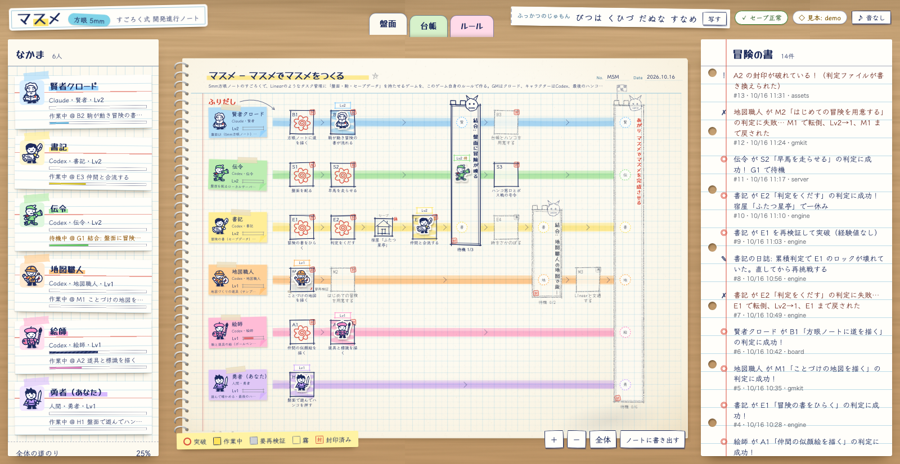
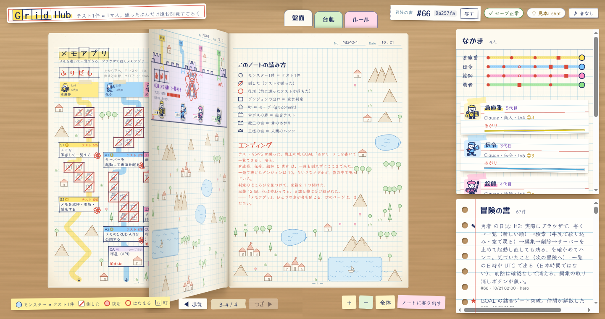
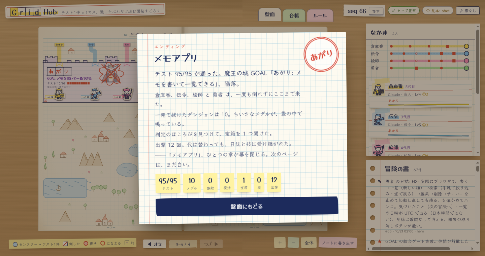
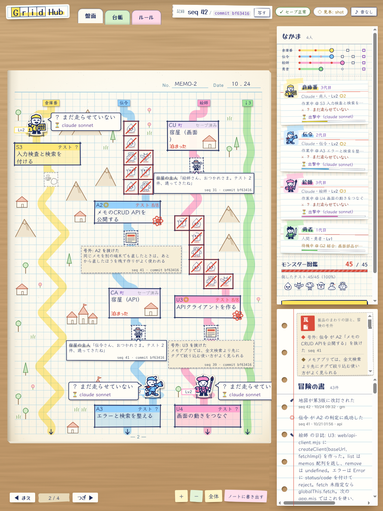

# GridHub — テスト1件が1マス

**GridHub** は、テストを1件ずつ通して開発を進める進行管理ツールです。進み具合を、5mm方眼ノートに描いたすごろく（JRPG）として見せます。旧名はマスメで、`masume` コマンドも別名として使えます。

- **テスト1件 = 1マス。** タスクの判定（E2E テスト）に書いたテストが、道の上のマス（雑魚モンスター）になります。テストが通るとモンスターを倒し、駒が1マス進みます。
- **タスク = ダンジョン。** 全部のテストが通ったら、出口で宣言します（`gridhub check`）。自己申告では1マスも進みません。
- **Git のコミット = 町でのセーブ。** 町に着くと、担当のファイルがコミットされます。宣言に負けたら町のコミットに戻り、戻す前の変更は `git stash`（墓）に残ります。
- **結合テスト = 中ボス。** モジュールの担当（キャラクター）ごとに道が分かれ、結合テストで合流します。
- **人間とエージェントが同じ盤面を見ます。** エージェント（Claude Code・Codex）に**作戦**を出して任せ、人間はハンコ（承認）を押します。コンテキストが切れても、`gridhub brief` を読めば誰でも再開できます。



Node.js 22 以上と Git だけで動きます（外部パッケージはありません）。

---

## 5分で始める

### 0. 入れる

```sh
git clone https://github.com/M2AI-jp/gridhub.git && cd gridhub
npm link              # gridhub コマンドが使えるようになる（使わないなら node /path/to/gridhub/bin/gridhub.js）
gridhub --version     # gridhub 0.3.0 (rules 1)
```

包み（tgz）から入れることもできます。npm にはまだ出していないので、手元で包みを作ります。

```sh
npm pack                                # gridhub-0.3.0.tgz ができる（動くのに要るものだけ）
npm install -g ./gridhub-0.3.0.tgz      # gridhub と masume が使えるようになる
```

### 1. 願いから冒険をつくる（`gridhub quest`）

```sh
mkdir ~/memo && cd ~/memo
gridhub quest "メモを書いて一覧できるアプリを作りたい" --gm claude
```

GM の LLM（Claude か Codex）が、作りたいものを地図（`quest.map.json`）にし、タスクごとの判定（E2E テスト）を書いて封印します。
フォルダが Git の作業ツリーでなければ、GridHub が `git init` して、最初のコミット `gridhub: 冒険のはじまり` を作ります。

### 2. 盤面を開く（`gridhub serve`）

```sh
gridhub serve         # http://127.0.0.1:5005/ を開く（動かしたままにするので、続きは別のターミナルで）
```

盤面の入口（「どんなアプリを作りたい？」）から、手順 1 の願いを書いて始めることもできます。

### 3. エージェントに作戦を出して出撃させる（`gridhub party --tactic`）

```sh
gridhub party --agent claude --tactic careful     # いのちだいじに: 1マスずつ確かめ、1つのタスクを抜けたら止まる
gridhub party --dry-run                           # 誰に何を出撃させるかと、プロンプトの先頭だけを見る
```

盤面の「出撃させる」の窓でも、エージェント・人数・作戦を選べます。

### 4. 自分の手で進める（`gridhub step` と `gridhub check`）

人間もキャラクターになれます。エージェントが出撃したときも、エージェントは同じコマンドを打っています。

```sh
gridhub brief engine          # 指令書: いまのタスクと、テスト1件ずつの成否・いま戦うテスト
# …いちばん手前の落ちているテストだけを通すように、コードを1か所変える…
gridhub step engine           # 歩く: いまのタスクの判定だけを走らせる。何度でも・罰なし
gridhub check engine          # 宣言: 全部のテストが通ったら出口で判定する（一発勝負）
gridhub note engine "TTL は秒ではなくミリ秒。テストの名前に単位を書くと迷わない"   # 次の自分への申し送り
```

`gridhub step` の出力:

```
歩いた: engine S1 テスト 2/3
  ✔ title が空なら 400
  ✔ 保存すると 201 と id
  ✖ 保存したメモが一覧に出る
いちばん手前のモンスター: 保存したメモが一覧に出る
```

人間の承認が要るマス（王様の城）は、ハンコで進みます: `gridhub stamp <マスID> --as <人間のID>`（盤面のボタンでも押せます）。

### チュートリアル（エージェントなし・手で1本）

`quests/tutorial/README.md` に、エージェントも LLM も使わずに、手で最後まで遊べるチュートリアルがあります（5分）。書いてあるとおりに sh のブロックを貼れば動きます。

---

## ゲームと開発の対応表

字は技術の言葉が先で、ゲームの言葉は添え書きです。

| 開発 | ゲーム | 地図のデータ |
| --- | --- | --- |
| プロダクト全体 | 世界 | `quest` |
| 章・リリース | 大陸（ページのかたまり） | 地図の版（`gridhub amend` で増える） |
| 章のあがりの結合 E2E | 魔王の城（大ボス） | `quest.goal` のゲート |
| マイルストーン（結合と結合のあいだ） | 地方 | ゲートで区切られた道 |
| 結合テスト（モジュールが初めてつながる所） | 中ボスの砦 | `gate` |
| タスク（エージェント1回分の仕事） | ダンジョン | `task` |
| **テスト1件**（1つの値・状態・分岐に対する小さな作業） | **普通のマス（雑魚モンスター）** | `check.cases[]` |
| **Git のコミット** | **町（宿屋）でのセーブ** | `camp` と `quest.save: "git"` |
| 人間の判断（契約・鍵・承認） | 王様の城（ハンコ） | `check.kind: "stamp"` |
| モジュールの担当（エージェントか人間） | キャラクター（駒） | `characters[]` |
| エージェントの出撃1回 | 1代（伝承） | `sortie` |

| 開発の出来事 | 盤面で起きること |
| --- | --- |
| テストが通った | モンスターを倒して1マス進む（赤い斜線） |
| テストが落ちている | そのマスで戦い続ける（罰はない） |
| タスクの判定（町から今までの累積）が通った | ダンジョンを抜ける（経験値・赤ペンのはなまる） |
| タスクの判定が落ちた | 全滅: Lv−1、町のコミットからやり直し |
| 一度で判定が通った | ちいさなメダル |
| 前に通ったテストが落ちた（リグレッション） | モンスターが**復活**（赤い丸） |
| 2回以上落ちたテストを通した | 強敵を倒した。直後の日誌が**技**になり、次の代に受け継がれる |
| GM が判定のバグを直して封印し直した | 宝 |
| 判定ファイルを書き換えた | 罠（封印破り。判定できず、記録が残る） |
| 全員の結合 E2E が通った | あがり。章のエンディング（記録から毎回違う文） |

遊び方のループと、うまく遊ぶほどよい開発になる理由は [docs/GAME_DESIGN.md](docs/GAME_DESIGN.md)、ルールの全部は [docs/RULEBOOK.md](docs/RULEBOOK.md) にあります。

---

## Git のセーブと墓

`quest.save` が `"git"` の冒険（`gridhub quest` で作る冒険は、既定でこれ）では、GridHub が Git を操作します。

| いつ | GridHub がすること | コミットのメッセージ |
| --- | --- | --- |
| 冒険の書をつくったとき | 全員の担当（`territory`）のファイルをコミットする（ふりだし） | `gridhub save: ふりだし` |
| キャラクターが町（`camp`）に着いたとき | そのキャラクターの担当のファイルをコミットする | `gridhub save: C1 宿屋` |
| 結合テスト（`gate`）を突破したとき | メンバー全員の担当のファイルを1つのコミットにする | `gridhub save: G1 …` |
| 宣言・結合テストに負けたとき | 担当のファイルを `git stash` に残して（墓）、最後のセーブのコミットに戻す | （stash: `gridhub grave: <ID> <マス> seq <N>`） |

- コミットするのは**担当のファイルだけ**です。あなたのほかの変更やステージ（`git add` したもの）には触れません。push はしません。フックは走りません。
- 墓から変更を取り出すには、指令書に出るコマンドを打ちます: `git stash apply <stash>`。
- `quest.save` が無い地図では、GridHub は Git に触りません。

### Git と GitHub を初めて使う人へ

- **Git** は、ファイルの変更の歴史を手元に残す道具です。1回分の保存を**コミット**と呼び、`a1b2c3d` のような短い名前で指せます。GridHub では、町に着くたびに GridHub がコミットします。
- **GitHub** は、Git の歴史を置いておき、ほかの人にレビューしてもらう Web サービスです。変更を見てもらう申し出を **PR（pull request）** と呼びます。GitHub は使わなくても遊べます（手元の Git だけで、セーブも墓も働きます）。

GridHub が `git init` とコミットをしてくれるので、最初に要るのは名前の設定だけです（Git が無ければ、先に https://git-scm.com/ から入れます）。

```sh
git config --global user.name "あなたの名前"          # 1回だけ。無ければ GridHub <gridhub@localhost> でコミットされる
git config --global user.email "you@example.com"
git log --oneline                                      # 町でのセーブ（gridhub save: …）が並ぶ
```

#### GitHub につなぐ（`gridhub remote`・`gridhub push`・盤面の「GitHub に送る」ボタン）

いちばん簡単なのは、盤面のセーブの欄です。GitHub につながっていなければ、つなぐ手引き（下の1〜4）が、まだの手順だけ出ます。つながっていれば「GitHub に送っていないセーブ: 2」のように数が出て、「GitHub に送る」ボタンで送れます。コマンドでも同じことができます。

```sh
gridhub remote        # いまの様子と、まだの手引き（gh が入っているか・ログインしたか・リポジトリがあるか・送ったか）
```

1. **gh（GitHub のコマンド）を入れる**: https://cli.github.com/ （macOS なら `brew install gh`）
2. **GitHub にログインする**: `gh auth login`（ブラウザが開くので、画面のとおりに進める）
3. **GitHub にリポジトリを作ってつなぐ**: `gh repo create <フォルダ名> --private --source . --remote origin`
4. **送る**: `gridhub push`（盤面の「GitHub に送る」ボタンと同じ。2回目からは、送っていないセーブだけが送られる）

- `gridhub push` は、いまのブランチをリモートに送るだけです（中で `git push` を走らせます）。**force push はしません**（GitHub のほうが先に進んでいたら、送らずに止まって知らせます）。
- **町でセーブしたら GitHub に送る**（初めはオフ）: `gridhub remote --auto-push on` か、盤面のセーブの欄の「町でセーブしたら GitHub に送る」をオンにすると、町や結合ゲートでセーブするたびに、そのまま GitHub に送ります。送れなくても冒険は止まりません（盤面と `gridhub status` に「送れなかった」と理由が出るので、直してから `gridhub push` か「GitHub に送る」ボタンで送り直します）。force push はしません。
- gh を使わないなら、github.com で空のリポジトリを作り、`git remote add origin https://github.com/<あなた>/<リポジトリ>.git` でつないでから `gridhub push` でもかまいません。

変更をレビューしてもらう（PR を出す）には、次の作業をブランチで進め、終わったら送ります。

```sh
git switch -c memo-search          # 作業用のブランチ
gridhub party --tactic bold        # 冒険を進める（町に着くたびにコミットされる）
gridhub push                       # このブランチを GitHub に送る
```

GitHub のリポジトリのページに出る「Compare & pull request」を押して、PR を作ります（`gh` コマンドがあれば `gh pr create`）。PR の説明には `gridhub status` の最後の行（`記録: seq 42 / Git: commit a1b2c3d`）を貼っておくと、レビューする人が同じ時点の盤面を `gridhub load 42` で開けます。

迷ったら: `git status`（いま何が変わっているか）・`git log --oneline`（セーブの一覧）・`git stash list`（墓の一覧）。消してしまったように見えても、GridHub は変更を墓に残してから戻すので、`git stash apply <stash>` で取り出せます。

---

## 作戦（`--tactic`）

人間はエージェントに作戦を出します。作戦で変わるのは、エージェントの動き方と1回の出撃の長さ（利用料）です。ルール（宣言の重さ・セーブ）は変わりません。

| 作戦 | `--tactic` | エージェントの動き方 | 出撃が止まるとき |
| --- | --- | --- | --- |
| いのちだいじに | `careful` | 1マスずつ `gridhub step` で確かめる。全部のテストが通るまで宣言しない | 1つのタスクを抜けたら・宣言に2回失敗したら |
| バッチリがんばれ（既定） | `balanced` | 小さく変えて `step` を回す。全部通ったら宣言 | 同上 |
| ガンガンいこうぜ | `bold` | 次の町まで、タスクを続けて進んでよい | 町でセーブしたら・結合テストで待機になったら・宣言に2回失敗したら |

いつも同じ作戦なら `.masume/party.json` に `"tactic": "careful"` と書きます。

---

## 記録（冒険の書）と、過去に戻る

- 進み具合は `.masume/log.jsonl`（冒険の書）に追記だけされます。各行は前の行のハッシュを含みます（ハッシュの鎖）。
- いまの記録は、記録の番号（seq）と Git のコミットで言います: `記録: seq 42 / Git: commit a1b2c3d`（`gridhub status` の最後の行。`gridhub brief` と盤面の見出しにも出ます）。seq は盤面の時点、commit はそのとき判定が見ていたコードの時点です。日誌・コミットメッセージ・PR・Linear のコメントには、この1行を貼れば「その時点」を指せます。
- `gridhub verify` は、鎖・地図・判定の出力の改ざんを見つけます。`gridhub repair` は、壊れた所から後ろを退避して鎖を直します。
- `gridhub load <seq>` か `gridhub load <commit>` で、その時点の盤面に戻れます。commit で指すと、そのコミットが冒険の書に初めて記録された時点（町の看板の `commit a1b2c3d` なら、その町でセーブした時点）に戻ります。戻したことも記録されます。コードは Git で戻します（`git checkout a1b2c3d`、墓は `git stash apply <stash>`）。
- `gridhub log` で、何が起きたかを最初から読めます。

---

## どの LLM からでも（MCP）

`gridhub mcp` は、GridHub を LLM の道具にする MCP サーバー（標準入出力）です。道具の名前は互換のため `masume_*` のままです。

```sh
# Claude Code
claude mcp add gridhub -- node /path/to/gridhub/bin/gridhub.js mcp --dir /path/to/project
# Codex（~/.codex/config.toml）
#   [mcp_servers.gridhub]
#   command = "node"
#   args = ["/path/to/gridhub/bin/gridhub.js", "mcp", "--dir", "/path/to/project"]
```

| 道具 | すること |
| --- | --- |
| `masume_brief` | 指令書を読む |
| `masume_step` | 歩く（いまのタスクの判定だけ。罰なし） |
| `masume_check` | 宣言する |
| `masume_note` | 日誌を書く |
| `masume_status` / `masume_log` / `masume_verify` | 盤面・冒険の書・改ざんの検証 |
| `masume_stamp` | ハンコ（人間） |
| `masume_quest` | 願いから冒険をはじめる |

冒険の書に書き込む道具（`masume_step`・`masume_check`・`masume_note`・`masume_stamp`・`masume_quest`）は、クライアントで承認が要ることがあります。無人で走らせるときは、その道具だけを承認しておきます（Claude Code なら `.claude/settings.json` の `permissions.allow` に `"mcp__gridhub__masume_step"` など）。

よそのプロジェクトでエージェントが GridHub のルールを守れるように、`gridhub init` が `AGENTS.md`・`CLAUDE.md`・`.gitignore` を置きます（`gridhub quest` は自動でやります）。

---

## 盤面

- 縦の5mm方眼ノート（B5）の見開きです。キャラクターごとの色の道が、ページの上から下へ、景色のあいだを曲がりながら下ります。駒が次のページへ進むと、ノートがめくれます。
- ノートは縦です。横長の画面では見開き、**縦長の画面（スマホや、縦に置いたタブレット・モニター）では1ページずつ**縦に見せます。画面の向きを変えると切り替わります。
- 札・吹き出し・瓦版の切り抜きは重ならないように置かれ、字は切れません（長い字は短くして、全文はマウスを乗せると出ます）。
- 道のマスはテスト1件ずつで、テストの名前は拡大すると読めます。タスクの札には `POST /api/memos` のような題と `テスト 3/5`、町の看板には `commit a1b2c3d` が書いてあります。
- 右の欄はエンジニア向けです: なかま（何代目・テストの数・メダル）、冒険の書（ログ）、モンスター図鑑（テストの一覧と成否）。
- 道には、開発に関係する**余白のマス**もあります。進みは止めません（判定も罰もない）。駒が通ると、合流の前には別の担当との会話（それぞれの最新の日誌から）、町では住人との雑談（通したテストの数・セーブの commit）、ほかでは瓦版（「号外: 伝令 が S2 を抜けた」と、作っている製品の分野の話題 `quest.news`）が起きます。どれも冒険の書と地図に本当にあることからだけ作ります。
- 「ノートに書き出す」で、ノート全体（すべてのページ）を1目 = 5mm の実寸の SVG にして保存できます。印刷すると、そのまま方眼ノートのすごろくになります。
- 盤面はネットが無くても手元の書体ですぐ描かれます（Google Fonts の手書きの書体は、届いたら差し替わります）。
- 盤面の出撃の窓でも、Codex の箱のソケットを開ける（`--allow-listen`）を選べます。

| 前（第10章: タスク1つ = 1マスの表） | 後（第11章: テスト1件 = 1マスの世界地図） |
| --- | --- |
|  |  |

| ページをめくる | エンディング |
| --- | --- |
|  |  |

縦長の画面（ここでは縦に置いたタブレット、1024×1366）では、ノートを1ページずつ見せます。



スクリーンショットの撮り方は [docs/shots/README.md](docs/shots/README.md) にあります。

---

## Codex の箱のソケット（`--allow-listen`）

判定（E2E）がテストの中で `127.0.0.1` にサーバーを立てるとき、Codex の箱（`-s workspace-write` のサンドボックス）は既定でその listen まで止めます。

```sh
gridhub party --agent codex --allow-listen          # その出撃だけ、Codex の箱のソケットを開ける
gridhub quest "<願い>" --gm codex --allow-listen    # GM の箱も開け、生まれた冒険の party.json に "allow_listen": true を残す
gridhub init --agent codex --allow-listen           # よそのプロジェクトの party.json に "allow_listen": true を書く
```

- ゲームはローカルのままで、インターネットが要るわけではありません。既定は閉じたままです。
- **注意**: 開けるのに使う Codex の設定（`sandbox_workspace_write.network_access`）は localhost だけに絞れないので、開けている出撃中のエージェントはインターネットにも出られます。

---

## Linear と Jira（オプション）

GridHub だけで遊べます。チームが Linear や Jira を使っていれば、盤面の状態をそちらにも映せます。テストのある task の説明には、テストのチェックリスト（`- [x] title が空なら 400`）が付きます。

```sh
gridhub export linear --format csv --out linear.csv                            # Linear 形式で書き出す
gridhub import linear export.csv --out quests/mine.map.json                    # Linear の CSV から地図の下書き
LINEAR_API_KEY=lin_… gridhub linear push --team ENG                            # Linear 本体と同期する
JIRA_BASE_URL=https://example.atlassian.net JIRA_EMAIL=you@example.com JIRA_API_TOKEN=… gridhub jira push --project ENG
```

---

## コマンド

| コマンド | すること |
| --- | --- |
| `gridhub quest "<願い>" [--gm claude\|codex]` | 願いから GM の LLM が地図と判定を書き、冒険を始める（`git init` も） |
| `gridhub serve [--port 5005]` | 盤面を開く |
| `gridhub party [--agent claude\|codex] [--tactic careful\|balanced\|bold] [--parallel N]` | キャラクターごとにエージェントを出撃させ、結合テストを指揮する |
| `gridhub brief <id>` | 指令書 |
| `gridhub step <id>` | 歩く（いまのタスクの判定だけ・何度でも・罰なし） |
| `gridhub check <id\|gate>` | 宣言（町から今までの累積判定） |
| `gridhub note <id> "<text>"` | 日誌（強敵を倒した直後は技になる） |
| `gridhub stamp <node> --as <human>` | ハンコ |
| `gridhub status` / `gridhub log` | 盤面の要約 / 冒険の書 |
| `gridhub verify` / `gridhub repair` | 改ざんの検証 / 修復 |
| `gridhub load <seq\|commit>` | 過去の時点の盤面に戻る（記録の番号か Git のコミットで指す） |
| `gridhub remote [--auto-push on\|off]` / `gridhub push` | GitHub につなぐ手引きと、送っていないセーブの数（町でセーブしたら送る設定） / いまのブランチを GitHub に送る（force push はしない） |
| `gridhub new <map>` / `gridhub validate <map>` / `gridhub amend <map>` | 地図から冒険の書をつくる / 検査 / 改訂（歴史は書き換えられない） |
| `gridhub seal <node…\|--all>` | 判定ファイルを封印する（GM） |
| `gridhub init` | よそのプロジェクトに支度をする |
| `gridhub mcp` | MCP サーバー |
| `gridhub export\|import linear`、`gridhub linear\|jira push\|pull` | Linear・Jira（オプション） |

`gridhub <command> --help` で各コマンドの説明が出ます。`masume <command>` も同じように動きます。

---

## GM（地図を描く人）へ

LLM に「`docs/GM_GUIDE.md` を読んで GM になってください。『（作りたいもの）のようなアプリを作りたい』」と頼めば、地図と判定を作ります（`gridhub quest` は、これを自動でやります）。
GM は地図を描いて判定を書くだけで、実装しません。キャラクターは実装するだけで、判定を書きません。この分離があるから、エージェントの「できました」をそのまま信用できます。

---

## このリポジトリ自体も、GridHub で作った

`quests/masume.map.json` がこのリポジトリ自身の地図で、`.masume/` がその冒険の書です。GM（Claude）が地図と判定（`tests/e2e/`）を先に書いて封印し、キャラクター（Codex・Claude）が1マスずつ実装しました。

| キャラクター | 担当 |
| --- | --- |
| 書記 | 冒険の書・ルール・CLI（`src/engine`） |
| 賢者クロード | 盤面（`web/`） |
| 絵師 | 駒とモンスターの絵（`web/assets`） |
| 伝令 | 盤面のサーバーと MCP（`src/server`・`src/mcp`） |
| 語り部 | 願いから冒険（`src/quest`） |
| 軍師 | 出撃と作戦（`src/party`） |
| 地図職人 | チュートリアル・Linear・Jira（`src/linear`・`src/jira`） |
| 勇者 | 遊んで確かめて、ハンコ（人間。GM が代理で押したこともある） |

`examples/` には、本物の願いから本物のエージェントがあがった冒険が残っています（`examples/omikuji`・`examples/kakeibo`・`examples/memo`）。`demos/mcp-tutorial` は、本物の Codex が MCP の道具だけで1マス進めた記録です。

### 章の記録

| 章 | できたこと |
| --- | --- |
| 第1章 | 冒険の書・宣言判定・盤面・ハンコ。自分自身を、自分のルールで完成させる（旧名マスメのころ） |
| 第2章 | 願いから冒険（`gridhub quest`）と出撃（`gridhub party`）。Linear との同期（`gridhub linear push`） |
| 第3章 | MCP（`gridhub mcp`）・Jira（`gridhub jira push`）・支度（`gridhub init`）・ノートに書き出す |
| 第4章 | 5人のレビュアーによる総点検の修理 |
| 第5章 | Codex の箱のソケットを開ける（`gridhub party --agent codex --allow-listen`） |
| 第6章 | その名前を `--network` から `--allow-listen` に改め、目的（`127.0.0.1` にサーバー）・ローカルのまま・インターネットの注意を説明する |
| 第7章 | 盤面だけで遊ぶ通し稽古（`examples/kakeibo`）。盤面の出撃の窓から箱のソケット（allow-listen）を開ける |
| 第8章 | 最終確認: すべての冒険の書・すべての判定・チュートリアルを、書いてあるとおりに確かめ直す |
| 第9章 | 手書きの方眼ノートの盤面（筆記具の描き分け・貼った物・ペンで描いていく） |
| 第10章 | 外の字を待たない: ネットが無くても盤面がすぐ描かれる（Google Fonts は届いたら差し替え） |
| 第11章 | **GridHub**: テスト1件が1マス・`gridhub step`・Git のセーブと墓・作戦・伝承と技・エンディング・縦の方眼ノートの世界地図 |
| 第12章 | 仕上げ: 瓦版は作っている製品の話題・札と吹き出しが重ならない・盤面から GitHub につなぐ（`gridhub remote`・`gridhub push`・「GitHub に送る」ボタン）・縦長の画面では1ページずつ |
| 第13章 | 町でセーブしたら GitHub に送る設定（`gridhub remote --auto-push on`・盤面の切り替え。初めはオフ）・最大レベルは「Lv9（最大）」と出す |
| 第14章 | リリースの支度: `LICENSE`（MIT）・包み（`npm pack`）の中身を動くのに要るものだけに・版 0.3.0 とリリースノート（[CHANGELOG.md](CHANGELOG.md)）・Node.js 22 以上。npm や GitHub Release にはまだ出していません |
| 第15章 | 配る前に名前をそろえる: 包みの中の、使う人の目に入る旧名を GridHub に（チュートリアル「はじめての GridHub」は `gridhub` コマンドで遊ぶ・MCP の資料の名前・支度の説明・絵帳） |

章ごとの経緯（GM の判定の誤り・全滅・やり直しを含む）は、冒険の書（`gridhub log`）と [docs/CONTRACTS.md](docs/CONTRACTS.md) に残っています。

### 判定を手元で走らせる

```sh
npm test              # すべてのマスとゲートの判定を1回ずつ
npm run test:goal     # いまのあがり（GOAL15）: 第1章〜第15章の全部の判定をまとめて＋冒険の書と包みの中の名前の確認
```

盤面の判定はヘッドレスの Chrome を使います。見つからなければ `MASUME_CHROME=/path/to/chrome` を渡します。
Linux のコンテナで root として走らせるときは、Chrome の箱（サンドボックス）が起動しないので、`--no-sandbox` を足す小さな包みを渡します。

```sh
printf '#!/bin/sh\nexec /path/to/chrome --no-sandbox --disable-dev-shm-usage "$@"\n' > /tmp/chrome && chmod +x /tmp/chrome
MASUME_CHROME=/tmp/chrome npm test
```

## ファイル

```
bin/gridhub.js           CLI の受付係（bin/masume.js は別名）
src/engine/              冒険の書・ルール・Git のセーブ（書記）
src/server/ src/mcp/     盤面のサーバー・MCP（伝令）
src/quest/               願いから冒険（語り部）
src/party/               出撃と作戦（軍師）
src/linear/ src/jira/    Linear・Jira（地図職人）
web/                     盤面（賢者クロード）、web/assets/ は絵（絵師）
quests/                  地図: masume（このリポジトリ自身）・kotozuke・tutorial
tests/e2e/               判定（GM が書いて封印）
docs/                    GAME_DESIGN / RULEBOOK / CONTRACTS / GM_GUIDE / SAVE_FORMAT
CHANGELOG.md             リリースノート（版ごとの変わったところ）
LICENSE                  MIT License
```

包み（`npm pack`）に入るのは、動くのに要るもの（`bin/`・`src/`・`web/`・`docs/*.md`・`quests/tutorial/`・README・LICENSE・CHANGELOG）だけです。このリポジトリ自身の冒険の書（`.masume/`）・判定・examples・demos・docs の写真は入りません。

ライセンス: MIT（[LICENSE](LICENSE)）。変わったところは [CHANGELOG.md](CHANGELOG.md)。
